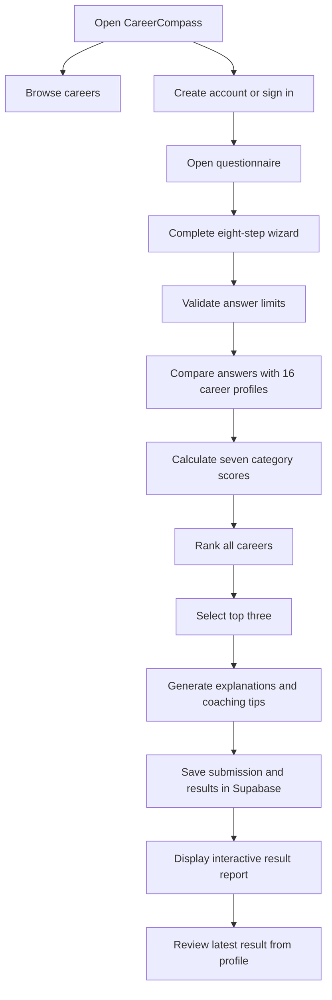
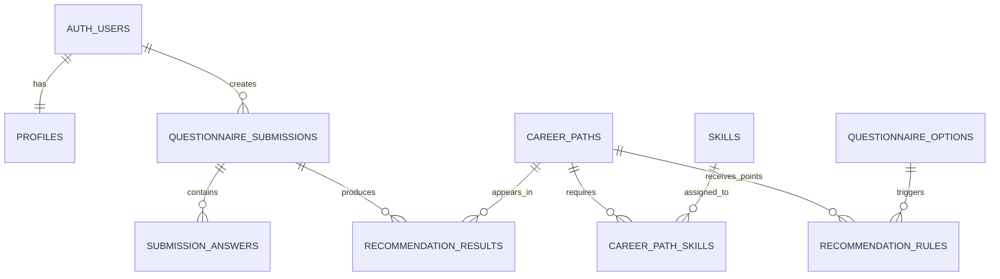

# CareerCompass Project Summary

## 1. Project Title

**Career Path Recommendation System for Computer Science Students**

Product name: **CareerCompass**

## 2. Project Overview

CareerCompass is a web-based recommendation system that helps Computer Science
students identify career paths that match their:

- Interests
- Existing skills
- Preferred work style
- Academic strengths
- Career goals
- Preferred activities
- Career priorities

The current version uses a transparent **rule-based recommendation engine** as
the main ranking method, supported by a Random Forest confidence check. Every
recommendation can therefore be explained using the student's answers, category
scores, matched skills, missing skills, predefined career profiles, and an
honest hybrid score breakdown.

The system presents the three strongest career matches instead of forcing the
student to accept only one result.

## 3. Project Objectives

The project aims to:

1. Help students explore Computer Science career options.
2. Produce personalized recommendations from questionnaire answers.
3. Explain why each recommended career fits or does not fully fit.
4. Identify skills that the student already has.
5. Identify important skills the student can improve.
6. Suggest courses, certifications, and practical next steps.
7. Store student profiles and recommendation history securely.
8. Keep scoring understandable and editable for a university-level project.

## 4. Technology Stack

| Layer | Technology |
|---|---|
| Frontend | HTML, CSS, JavaScript |
| Template engine | Jinja |
| Backend | Python Flask |
| Authentication | Supabase Auth |
| Database | Supabase PostgreSQL |
| Database API | Supabase Python client |
| Local development | Flask development server |
| Current local URL | `http://127.0.0.1:5000` |

The interface is implemented using ordinary HTML, CSS, JavaScript, and Jinja.
It does not currently require React or Tailwind CSS.

## 5. Main Features

### 5.1 Public Homepage

The homepage includes:

- CareerCompass introduction
- Main call-to-action for starting the recommendation
- Career browsing link
- Career roadmap illustration
- Bento-style information cards
- Explanation of evidence categories
- Explanation of ranked recommendations
- Career search
- Sixteen clickable career cards
- Career-specific SVG icons
- Technology and skill badges

### 5.2 Career Library

Students can browse and search the following 16 careers:

1. Software Engineer
2. Full Stack Developer
3. Mobile App Developer
4. Data Analyst
5. Cybersecurity Analyst
6. Network Engineer
7. UI/UX Designer
8. Database Administrator
9. AI/ML Engineer
10. Data Scientist
11. Cloud Engineer
12. Business Analyst
13. Game Developer
14. DevOps Engineer
15. Systems Analyst
16. Software QA/Test Automation Engineer

Each career has:

- Name
- Description
- Core skills
- Suitable interests
- Preferred work styles
- Typical activities
- Suggested courses
- Search keywords
- Career-specific icon
- Technology badges

### 5.3 Account Registration and Login

Students can:

- Create an account using email and password
- Sign in
- Sign out
- Access protected pages after authentication

When Supabase is configured, passwords and authentication are managed by
Supabase Auth. The application does not store plain-text passwords.

If Supabase credentials are missing, a temporary in-memory fallback is used for
local development. Fallback accounts disappear whenever Flask restarts.

### 5.4 Protected Navigation

Signed-out users see only:

- Home
- Careers

Signed-in users additionally see:

- Recommend
- Profile

The floating bottom navigation remains visible throughout the application.

### 5.5 Student Profile

The profile page allows students to:

- View and update their full name
- View their email
- Enter their academic programme
- Select their year of study
- Review their latest recommendation
- Reopen their latest result
- Sign out

### 5.6 Multi-Step Questionnaire

The questionnaire is an eight-step wizard.

| Step | Section |
|---:|---|
| 1 | Core Interests |
| 2 | Current Skills |
| 3 | Preferred Work Style |
| 4 | Academic Strengths |
| 5 | Career Goals |
| 6 | Preferred Activities |
| 7 | Career Priorities |
| 8 | Optional Student Details |

The wizard includes:

- One question section at a time
- Progress bar
- Current-step label
- Back and Next buttons
- Free-text description box for each main question
- AI button that suggests matching existing options from the user's text
- Selection limits
- Client-side step validation
- Server-side validation
- Selected-card visual state
- Final submission button

The questionnaire is protected. Students must sign in before accessing it.

The LLM-assisted option suggestion does not replace the recommender. It maps
free-text descriptions to existing questionnaire option codes, and the user can
review the selected options before submitting.

### 5.7 Recommendation Results

The result page displays the three highest-ranked careers.

Students can switch between the results using tabs. Each result includes:

- Rank position
- Career name and description
- Match percentage
- Match tier
- Category score breakdown
- Progress bars
- Answers that matched
- Why the career suits the student
- Why it may not fully suit the student
- Existing matched core skills
- Skills to develop
- Suggested courses
- Career coach tip

### 5.8 Career Coach Tips

Career coach tips are currently deterministic and predefined by score range.
They are not generated by an external AI model.

- Very strong matches encourage portfolio building and starting a recommended
  course.
- Good matches focus on the first missing skill and professional exploration.
- Exploratory matches recommend a beginner course and a small practical task.

The tip dynamically includes the career name, suggested course, and missing
skill where appropriate.

### 5.9 Offline Career Assistant

An assistant appears on every page in the bottom-right corner.

It can answer predefined questions about:

- Recommendation scores
- Match percentages
- Skills
- Suggested courses
- Questionnaire answers
- Match tiers
- Accounts and profiles

The assistant uses Gemini when `GEMINI_API_KEY` and `GEMINI_MODEL` are
configured. If Gemini is unavailable, the system falls back to a predefined
offline reply so the chatbot page still works during demonstrations.

## 6. Rule-Based Recommendation Engine

### 6.1 Evidence Categories

The recommendation engine uses seven weighted categories. Their weights total
100 points.

| Category | Maximum points | Selection rule |
|---|---:|---|
| Interests | 20 | Select 1–3 |
| Current skills | 25 | Select 2–5 |
| Preferred work style | 10 | Select 1–2 |
| Academic strengths | 15 | Select 1–3 |
| Career goals | 10 | Select 1–2 |
| Preferred activities | 15 | Select 1–3 |
| Career priorities | 5 | Select 1–2 |
| **Total** | **100** | |

### 6.2 Career Profiles

Every career has a predefined profile containing relevant:

- Interest codes
- Skill codes
- Work-style codes
- Subject codes
- Goal codes
- Activity codes
- Priority codes
- Core skills
- Suggested courses

The profiles are stored in `recommendation_rules.py`.

### 6.3 Scoring Formula

For each career and questionnaire category:

```text
Category score =
Category weight × Matching selected answers ÷ Total selected answers
```

Example:

```text
Skills weight: 25 points
Student selected: 5 skills
Skills matching Cloud Engineer: 3

Skills score = 25 × 3 ÷ 5
             = 15 points
```

The seven category scores are added:

```text
Final career score =
Interests + Skills + Work Style + Subjects +
Goals + Activities + Priorities
```

Because the maximum total is 100, the rule-based score is an explainable match
percentage. The displayed final recommendation score is now calculated using
the hybrid formula below.

### 6.4 Hybrid Recommendation Score

Career ranking still follows the rule-based recommender because it is easier to
justify academically. The final displayed percentage combines rule evidence,
Random Forest confidence, and system agreement:

```text
Final Score =
(Rule-based Score x 0.65) +
(Random Forest Score x 0.25) +
(Agreement Score x 0.10)
```

Agreement score:

- 100 if the Random Forest top career matches the rule-based career
- 70 if the rule-based career appears in the Random Forest top 3
- 40 if the rule-based career does not appear in the Random Forest top 3

No artificial minimum percentage floor is applied.

### 6.5 Recommendation Levels

| Level | Percentage |
|---|---:|
| Strong Match | 80-100% |
| Good Match | 60-79% |
| Moderate Match | 40-59% |
| Low Match | Below 40% |

The result page also shows the separate rule-based score, ML confidence, system
agreement, and a short explanation note.

### 6.6 Ranking

The system:

1. Calculates a score for all 16 careers.
2. Sorts careers by percentage from highest to lowest.
3. Uses career name as a deterministic secondary ordering rule.
4. Returns the top three careers.

The same answers always produce the same result.

### 6.7 Explanation Generation

For each recommended career, the engine identifies:

- Strongest matching categories
- Points earned in each category
- Answers that supported the career
- Answers that did not support the career
- Core skills already selected
- Core skills not selected
- Suggested learning resources
- Appropriate coaching tip

This makes the recommendation explainable rather than presenting only a score.

## 7. Software QA/Test Automation Profile

The added QA career supports students who:

- Enjoy finding errors
- Prefer systematic work
- Pay close attention to detail
- Like testing applications
- Enjoy writing test cases
- Prefer quality assurance over building complete features
- Are interested in automated testing

Important QA profile evidence includes:

- Software testing interest
- Test-case design
- Debugging
- Attention to detail
- Automated testing
- Documentation
- Testing features
- Reproducing bugs
- Writing automated tests
- Checking requirements
- Careful and systematic work

Suggested learning includes:

- Software Testing Fundamentals
- Selenium WebDriver
- Unit Testing
- Test Automation Frameworks

## 8. Application Workflow



## 9. Supabase Database Design

Supabase uses PostgreSQL tables rather than document collections.

### 9.1 Tables

| Table | Purpose |
|---|---|
| `auth.users` | Supabase-managed authentication accounts |
| `profiles` | Student profile information |
| `career_paths` | Career names, descriptions, and courses |
| `skills` | Reusable skill catalogue |
| `career_path_skills` | Many-to-many career/skill relationship |
| `questionnaire_options` | Available answer options |
| `recommendation_rules` | Database-ready weighted rule definitions |
| `questionnaire_submissions` | Completed questionnaire attempts |
| `submission_answers` | Individual answers for each submission |
| `recommendation_results` | Top-three persisted results |

### 9.2 Relationship Overview



### 9.3 Current Rule Storage

The active recommendation rules currently run from
`recommendation_rules.py`.

The Supabase `questionnaire_options` and `recommendation_rules` tables are
included for a future administrator feature. Moving rules into the database
would allow rules to be edited without modifying Python.

### 9.4 Stored Recommendation Data

When Supabase is configured, a completed questionnaire creates:

1. One `questionnaire_submissions` row.
2. Multiple `submission_answers` rows.
3. Three `recommendation_results` rows.

The result records store:

- Rank
- Career
- Score
- Percentage
- Match tier
- Explanation JSON
- Coach tip
- Creation time

## 10. Authentication and Sessions

### 10.1 Supabase Mode

When `SUPABASE_URL` and `SUPABASE_KEY` are configured:

- Supabase Auth handles registration and login.
- Supabase hashes and stores passwords securely.
- Flask stores the Supabase access and refresh tokens in its session.
- The profile trigger creates a `profiles` row for every new Auth user.
- Profile and result queries use the authenticated Supabase session.

### 10.2 Local Fallback Mode

When Supabase credentials are absent:

- Accounts are stored in the `DEMO_USERS` Python dictionary.
- Passwords are hashed with Werkzeug.
- Results are stored temporarily in `RESULT_CACHE`.
- Data disappears when Flask restarts.

Fallback mode is intended only for local interface development.

## 11. Security Features

Implemented security measures include:

- Supabase Auth for production-style user authentication
- Password hashing in local fallback mode
- HTTP-only Flask session cookie
- SameSite session cookie setting
- CSRF tokens for state-changing forms
- Login protection for questionnaire, profile, and results
- Input length limits
- Server-side questionnaire validation
- Supabase Row Level Security
- User-owned profile, submission, answer, and result policies
- No service-role key required by the student application
- No plain-text password storage
- Environment variables for credentials
- `.env` excluded from source control

Production deployment should also use:

- HTTPS
- A strong Flask `SECRET_KEY`
- Email confirmation
- Reliable SMTP configuration
- Rate limiting
- Secure hosting
- Error logging and monitoring

## 12. Row Level Security

The Supabase schema enables RLS for application tables.

Current policies allow:

- Public reading of active careers
- Public reading of skills and career-skill links
- Public reading of active questionnaire options and rules
- Students to read and update only their own profile
- Students to insert and read only their own submissions
- Students to insert and read answers belonging to their own submissions
- Students to insert and read only their own recommendation results

## 13. Routes

| Route | Method | Purpose | Login required |
|---|---|---|---|
| `/` | GET | Homepage and career library | No |
| `/signup` | GET, POST | Create account | No |
| `/login` | GET, POST | Sign in | No |
| `/logout` | POST | Sign out | Yes |
| `/profile` | GET, POST | View/update profile | Yes |
| `/career/<career_key>` | GET | Career details | No |
| `/questionnaire` | GET, POST | Complete assessment | Yes |
| `/result` | GET | View top-three results | Yes |
| `/admin/login` | GET | Current admin placeholder | No |

## 14. User Interface Design

### 14.1 Palette

| Role | Color | Hex |
|---|---|---|
| Primary | Deep Blue | `#2563EB` |
| Secondary | Indigo | `#4F46E5` |
| Accent | Emerald Green | `#10B981` |
| Background | Light Gray | `#F8FAFC` |
| Card | White | `#FFFFFF` |
| Text | Dark Gray | `#1F2937` |

### 14.2 Interface Style

The visual design uses:

- White cards
- Light gray borders
- Soft shadows
- Rounded corners
- Blue accents
- Emerald positive indicators
- Amber growth indicators
- Responsive grids
- Floating bottom navigation
- Career-specific SVG icons
- Animated wizard and result transitions

## 15. Project File Structure

```text
CSC649/
├── app.py
├── demo_app.py
├── config.py
├── recommendation_rules.py
├── supabase_schema.sql
├── requirements.txt
├── requirements-demo.txt
├── .env.example
├── .gitignore
├── README.md
├── static/
│   ├── style.css
│   └── script.js
└── templates/
    ├── base.html
    ├── index.html
    ├── signup.html
    ├── login.html
    ├── profile.html
    ├── questionnaire.html
    ├── result.html
    ├── career_detail.html
    ├── admin_dashboard.html
    └── error.html
```

## 16. Important Files

### `app.py`

Conventional Flask entry point. It imports the active application from
`demo_app.py`.

### `demo_app.py`

Contains:

- Flask routes
- Supabase client creation
- Authentication logic
- Session management
- Profile operations
- Recommendation calculation
- Questionnaire persistence
- Result reconstruction
- Local fallback behavior

### `recommendation_rules.py`

Contains:

- Category weights
- Selection limits
- Questionnaire options
- Sixteen career profiles
- Core skill definitions
- Suggested courses
- Match tier logic

### `supabase_schema.sql`

Contains:

- PostgreSQL table definitions
- Profile creation trigger
- RLS activation
- RLS policies
- Career seed data

### `templates/`

Contains all Jinja HTML pages and shared navigation.

### `static/style.css`

Contains the responsive layout, color system, dashboard, wizard, report,
profile, icons, assistant, and navigation styling.

### `static/script.js`

Contains:

- Maximum-selection enforcement
- Questionnaire wizard behavior
- Step validation
- Result tab switching
- Career search
- Admin tab behavior
- Confirmation dialogs
- Offline assistant responses

## 17. Local Setup

### 17.1 Create and activate the environment

```powershell
cd C:\Users\user\Documents\Codex\2026-06-10\files-mentioned-by-the-user-master\CSC649
python -m venv .venv
.\.venv\Scripts\Activate.ps1
```

### 17.2 Install dependencies

```powershell
pip install -r requirements.txt
```

### 17.3 Configure environment variables

Copy the example:

```powershell
Copy-Item .env.example .env
```

Required values:

```dotenv
SECRET_KEY=your-long-random-secret
SUPABASE_URL=https://your-project.supabase.co
SUPABASE_KEY=your-publishable-or-anon-key
FLASK_DEBUG=1
```

### 17.4 Start the application

```powershell
flask --app app run --host 127.0.0.1 --port 5000
```

Open:

```text
http://127.0.0.1:5000
```

## 18. Supabase Setup

1. Create a Supabase project.
2. Open Supabase SQL Editor.
3. Run `supabase_schema.sql`.
4. Confirm the public tables in Table Editor.
5. Copy the project URL and publishable/anon key.
6. Add them to `.env`.
7. Configure Email authentication.
8. For local testing, either disable email confirmation or confirm the email
   before signing in.
9. Restart Flask after changing `.env`.

## 19. Testing Completed

During development, the following have been checked:

- Python syntax compilation
- JavaScript syntax
- Homepage route
- Sixteen career cards
- Career detail routes
- Signed-out navigation restrictions
- Protected questionnaire redirection
- Local signup and profile flow
- Multi-step wizard rendering
- Questionnaire server validation
- Top-three result generation
- Result tab markup
- QA/Test Automation recommendation
- Profile latest-result display
- Supabase-ready configuration
- HTTP response from localhost

## 20. Current Limitations

### 20.1 Administrator Management

An older administrator dashboard template exists, but the current Supabase
student application does not expose a complete Supabase-backed administrator
workflow.

A future admin feature should manage:

- Career paths
- Skills
- Questionnaire options
- Rule weights
- Active/inactive rules
- Recommendation reports

### 20.2 Database-Managed Rules

The active rules are still Python definitions. The database schema is ready for
database-managed rules, but the scoring engine has not yet been switched to
read them from Supabase.

### 20.3 Generative AI

The chatbot can use Gemini, but it depends on a valid Gemini API key and model
name in `.env.local`. If Gemini is unavailable, the offline fallback answers
keep the page usable. Career coach tips are still predefined project content.

### 20.4 Result Recovery

The application persists results in Supabase, but the immediate result view
also uses an in-process cache. A stronger production version should support
opening any historical result directly by submission ID.

### 20.5 Production Deployment

The project currently uses Flask's development server. A deployed version
should use a production server and HTTPS.

## 21. Recommended Future Improvements

1. Build a Supabase-backed admin dashboard.
2. Load questionnaire options and rules directly from Supabase.
3. Add a recommendation-history page.
4. Add direct links such as `/result/<submission_id>`.
5. Add password reset and resend-confirmation flows.
6. Add Google OAuth.
7. Add automated unit and integration tests.
8. Add charts for aggregated student interests and recommendations.
9. Add course links and certification providers.
10. Add optional real AI explanations with strict safeguards.
11. Add accessibility testing and keyboard refinements.
12. Deploy the Flask application to a hosted environment.

## 22. Suggested Two-Week Project Plan

| Days | Work |
|---|---|
| 1–2 | Confirm requirements, careers, and questionnaire categories |
| 3–4 | Configure Supabase Auth and database schema |
| 5–6 | Complete scoring profiles and questionnaire |
| 7–8 | Implement results and explanations |
| 9 | Complete profile and persistence |
| 10 | Refine homepage and career details |
| 11 | Test authentication and RLS |
| 12 | Conduct student usability testing |
| 13 | Fix defects and prepare screenshots |
| 14 | Complete report, presentation, and demonstration |

## 23. Conclusion

CareerCompass is a working, explainable career recommendation system designed
for Computer Science students. It combines a multi-step assessment, weighted
rule-based ranking, Random Forest confidence support, sixteen career profiles,
top-three recommendations, detailed explanations, profile management, Gemini
chatbot support, and Supabase persistence.

Its main academic strength is transparency: students and evaluators can inspect
how every category contributes to the result. The system is suitable as a
university project and provides a clear path toward administrator management,
historical reporting, Google OAuth, and optional AI-assisted guidance.
