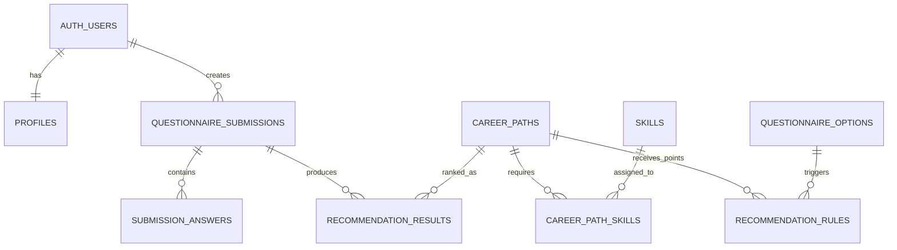

# Recommended Supabase Tables

## System Overview

Supabase uses PostgreSQL **tables**, not document collections. The recommended
design separates authentication, student profiles, career reference data,
questionnaire answers, rules, and recommendation history.

## Table Summary

| Table | Purpose |
|---|---|
| `auth.users` | Supabase-managed user accounts and passwords |
| `profiles` | Student profile information |
| `career_paths` | The 15 available Computer Science careers |
| `skills` | Reusable catalogue of technical and soft skills |
| `career_path_skills` | Links skills to careers |
| `questionnaire_options` | Selectable questionnaire answers |
| `recommendation_rules` | Weighted links between answers and careers |
| `questionnaire_submissions` | Current/latest completed questionnaire attempt |
| `submission_answers` | Individual answers selected in each attempt |
| `recommendation_results` | The latest three ranked career recommendations |

---

## 1. `auth.users`

This table is created and managed automatically by Supabase Auth.

Stores:

- User ID
- Email
- Encrypted authentication information
- Email confirmation status
- Account timestamps

The application must never store plain-text passwords in a public table.

---

## 2. `profiles`

Stores editable student information. Its `id` matches the user's
`auth.users.id`.

| Column | Type | Description |
|---|---|---|
| `id` | `uuid` | Primary key and reference to `auth.users` |
| `email` | `text` | Student email |
| `full_name` | `text` | Student name |
| `program` | `text` | Academic programme |
| `study_year` | `text` | Current year of study |
| `role` | `text` | `student` or `admin` |
| `created_at` | `timestamptz` | Creation time |
| `updated_at` | `timestamptz` | Last profile update |

Relationship:

```text
auth.users 1 ─── 1 profiles
```

---

## 3. `career_paths`

Stores the careers displayed and evaluated by the system.

| Column | Type | Description |
|---|---|---|
| `id` | `uuid` | Primary key |
| `slug` | `text` | Unique code such as `cybersecurity` |
| `name` | `text` | Career name |
| `description` | `text` | Career explanation |
| `suggested_courses` | `text[]` | Courses or certifications |
| `is_active` | `boolean` | Whether the career is available |
| `created_at` | `timestamptz` | Creation time |

Examples include Software Engineer, Data Scientist, Cloud Engineer,
Cybersecurity Analyst, and UI/UX Designer.

---

## 4. `skills`

Stores each skill once so it can be reused across several careers.

| Column | Type | Description |
|---|---|---|
| `id` | `uuid` | Primary key |
| `code` | `text` | Machine-readable code such as `python` |
| `name` | `text` | Display name such as `Python` |

---

## 5. `career_path_skills`

Creates the many-to-many relationship between careers and skills.

| Column | Type | Description |
|---|---|---|
| `career_path_id` | `uuid` | Reference to `career_paths` |
| `skill_id` | `uuid` | Reference to `skills` |
| `is_core` | `boolean` | Whether the skill is essential |

Composite primary key:

```text
(career_path_id, skill_id)
```

Relationship:

```text
career_paths many ─── many skills
```

---

## 6. `questionnaire_options`

Stores every answer that may appear in the questionnaire.

| Column | Type | Description |
|---|---|---|
| `id` | `uuid` | Primary key |
| `category` | `text` | Questionnaire category |
| `code` | `text` | Machine-readable answer code |
| `label` | `text` | Text shown to students |
| `is_active` | `boolean` | Whether the option is available |

Supported categories:

- `interests`
- `skills`
- `work_styles`
- `subjects`
- `goals`
- `activities`
- `priorities`

The combination of `category` and `code` must be unique.

---

## 7. `recommendation_rules`

Defines how questionnaire answers contribute points to career paths.

| Column | Type | Description |
|---|---|---|
| `id` | `uuid` | Primary key |
| `career_path_id` | `uuid` | Career receiving the points |
| `option_id` | `uuid` | Matching questionnaire option |
| `points` | `numeric` | Points added when matched |
| `reason` | `text` | Human-readable explanation |
| `is_active` | `boolean` | Whether the rule is enabled |

Example:

```text
Option: Python
Career: AI/ML Engineer
Points: 8
Reason: Python is commonly used to build machine-learning systems.
```

This table allows administrators to modify scoring without editing Python.

---

## 8. `questionnaire_submissions`

Represents the user's current/latest completed questionnaire attempt. When the
student retakes the questionnaire, the app saves the new submission and removes
older saved submissions for that user.

| Column | Type | Description |
|---|---|---|
| `id` | `uuid` | Primary key |
| `user_id` | `uuid` | Student who submitted it |
| `answers` | `jsonb` | Complete answer snapshot |
| `recommendation_summary` | `jsonb` | Snapshot of the latest top 3 career names, ranks, percentages, and tiers |
| `created_at` | `timestamptz` | Submission time |

The JSON snapshot preserves the exact answers used when the recommendation was
calculated.

---

## 9. `submission_answers`

Stores each selected answer as a separate normalized row. This table should keep
questionnaire choices only; career path results belong in `recommendation_results`.

| Column | Type | Description |
|---|---|---|
| `id` | `uuid` | Primary key |
| `submission_id` | `uuid` | Reference to the submission |
| `category` | `text` | Answer category |
| `option_code` | `text` | Selected option code |

This supports reports such as:

- Most commonly selected skills
- Popular career goals
- Frequent student interests
- Answer trends by programme or study year

---

## 10. `recommendation_results`

Stores each of the latest top three ranked career recommendations. These rows are
linked to the latest `questionnaire_submissions` row and are replaced when the
student retakes the questionnaire.

| Column | Type | Description |
|---|---|---|
| `id` | `uuid` | Primary key |
| `submission_id` | `uuid` | Questionnaire attempt |
| `user_id` | `uuid` | Result owner |
| `career_path_id` | `uuid` | Recommended career |
| `rank_position` | `smallint` | Rank from 1 to 3 |
| `score` | `numeric` | Calculated rule score |
| `match_percentage` | `smallint` | Percentage from 0 to 100 |
| `match_tier` | `text` | Perfect, Great, Good, or Exploratory |
| `explanation` | `jsonb` | Score breakdown, matches, and gaps |
| `coach_tip` | `text` | Personalized next-step guidance |
| `created_at` | `timestamptz` | Result creation time |

---

## Relationship Diagram



## Rule-Based Workflow

1. A student creates an account through Supabase Auth.
2. Supabase automatically creates a matching `profiles` row.
3. The student completes the questionnaire.
4. One latest `questionnaire_submissions` row is created.
5. Every selection is stored in `submission_answers`.
6. Answers are compared with `recommendation_rules`.
7. Points are added for every matching career rule.
8. Careers are sorted by their final score.
9. The top three are stored in `recommendation_results`.
10. Older saved submissions for that same user are removed, so the account keeps
    the newest top 3 recommendation set.
11. The result page displays percentages, tiers, evidence, skill gaps, courses,
    and coaching tips.

## Match Tiers

| Tier | Percentage |
|---|---:|
| Perfect | 95–100% |
| Great | 90–94% |
| Good | 80–89% |
| Exploratory | Below 80% |

## Security

Enable Supabase Row Level Security so:

- Students can read and update only their own profile.
- Students can create and read only their own submissions.
- Students can create and read only their own results.
- Career paths, skills, questionnaire options, and active rules are publicly
  readable reference data.
- Administrative updates require an authorized admin workflow.

The executable PostgreSQL schema is available in `supabase_schema.sql`.
