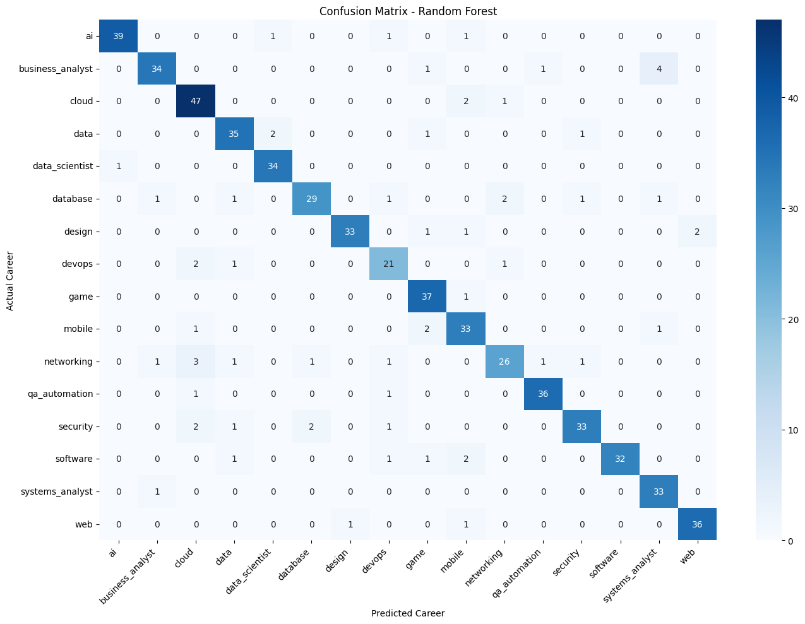

# 🧭 Computer Science Career Path Recommender System (Career Compass AI)


-10B981?style=for-the-badge&logo=scikitlearn)


**Computer Science Career Path Recommender System (Career Compass)** is an intelligent hybrid web application built with **Python Flask, Scikit-Learn (Random Forest Classifier), Supabase PostgreSQL, and Google Gemini AI**. It empowers Computer Science undergraduates to discover their optimal career tracks across **16 specialized CS domains** by combining an explainable **7-Category Rule-Based Scoring Engine** with a **Random Forest Machine Learning Model (`89.67%` accuracy)** and an interactive **AI Career Advisor Chatbot**.

---

## 🌟 Key Features

### 1. 🧠 Hybrid Career Recommendation Engine (Rule-Based + Random Forest ML)
- **7-Category Multi-Dimensional Assessment (`questionnaire.html`, `recommendation_rules.py`)**:
  - Evaluates students across 7 weighted dimensions totaling **100 points**: Technical Skills, Programming Languages, Academic Interests, Work Style Preferences, Soft Skills, Problem-Solving Approach, and Industry Domain Interests.
- **Random Forest Classifier Second-Opinion (`career_model.zip` + `mlb_transformer.pkl`)**:
  - Encodes the student's selected questionnaire responses into **94 binary features** using `MultiLabelBinarizer` and predicts class probabilities across all 16 Computer Science career paths.
- **Transparent Hybrid Scoring Formula**:
  $$\text{Final Hybrid Score} = (\text{Rule Score} \times 0.65) + (\text{ML Confidence} \times 0.25) + (\text{System Agreement} \times 0.10)$$
- **Auto-Extraction Model Loader**:
  - Automatically extracts [`02_EXPERIMENTAL_DATA/career_model.zip`](02_EXPERIMENTAL_DATA/career_model.zip) on first startup so the application works out-of-the-box after cloning.

### 2. 🎯 Coverage Across 16 Computer Science Career Paths
The system recommends and ranks the **Top 3 Most Suitable Career Paths** with detailed skill roadmaps, recommended university courses, and job roles across 16 CS tracks:
1. **Artificial Intelligence / ML Engineer (`ai`)**
2. **Data Scientist (`data_scientist`)**
3. **Data Analyst / BI Engineer (`data`)**
4. **Software Engineer (`software`)**
5. **Full-Stack Web Developer (`web`)**
6. **Mobile Application Developer (`mobile`)**
7. **Cybersecurity Analyst (`security`)**
8. **Cloud Solutions Architect (`cloud`)**
9. **DevOps & Site Reliability Engineer (`devops`)**
10. **Network & Infrastructure Engineer (`networking`)**
11. **Database Administrator / Data Engineer (`database`)**
12. **UI/UX Product Designer (`design`)**
13. **Game Developer (`game`)**
14. **QA & Test Automation Engineer (`qa_automation`)**
15. **Business Analyst (`business_analyst`)**
16. **Systems Analyst (`systems_analyst`)**

### 3. 🤖 Interactive AI Career Guidance Chatbot (`chatbot.html`)
- Powered by **Google Gemini (`gemini-2.5-flash-lite`)** with an intelligent **Offline Knowledge-Base Fallback** so career guidance remains 100% functional even without internet or API credits.
- Context-aware: references the student's latest top career recommendations, match percentages, and skill gaps to provide personalized roadmap advice, interview preparation, and Malaysian tech market insights.

### 4. 🔐 Supabase Cloud Authentication & Student Portfolio (`supabase_schema.sql`)
- **Supabase Auth + Row Level Security (RLS)** with automatic fallback to local in-memory demo mode if `.env` credentials are not configured.
- **Student Profile & Assessment History (`profile.html`, `result.html`)** and **Admin Analytics Dashboard (`admin_dashboard.html`)**.

---

## 📊 Experimental Machine Learning Performance (`02_EXPERIMENTAL_DATA/`)

The **Random Forest Classifier** (`n_estimators=400, class_weight='balanced', oob_score=True, random_state=42`) was trained and evaluated on [`01_DATASET/career_training_data_dummy.csv`](01_DATASET/career_training_data_dummy.csv) (**3,000 samples**: 2,400 train / 600 test) and benchmarked against a baseline **Decision Tree Classifier**:

| Evaluation Metric | Random Forest Classifier | Baseline Decision Tree |
| :--- | :---: | :---: |
| **Test Accuracy** | **89.67%** (`0.8967`) | 72.50% (`0.7250`) |
| **Out-of-Bag (OOB) Score** | **87.79%** (`0.8779`) | N/A |
| **Weighted Precision** | **90.05%** (`0.9005`) | 73.12% (`0.7312`) |
| **Weighted Recall** | **89.67%** (`0.8967`) | 72.50% (`0.7250`) |
| **Weighted F1-Score** | **89.65%** (`0.8965`) | 72.46% (`0.7246`) |
| **Misclassification Rate** | **10.33%** (`0.1033`) | 27.50% (`0.2750`) |

### Confusion Matrix (Random Forest across 16 CS Career Classes)


---

## 🗄️ Supabase PostgreSQL Database Schema (`03_SOURCE_CODE/supabase_schema.sql`)

| Table Name | Purpose |
| :--- | :--- |
| `profiles` | Student full name, email, programme, study year, and role (`student` / `admin`) |
| `career_paths` | Master catalogue of the 16 CS career paths, descriptions, and suggested courses |
| `skills` | Reusable technical and soft skill catalogue |
| `career_path_skills` | Many-to-many associative table linking careers and required skills |
| `questionnaire_options` | Available questionnaire choices across all 7 assessment categories |
| `recommendation_rules` | Database-managed weighted scoring rules |
| `questionnaire_submissions` | Header record for each completed student assessment |
| `submission_answers` | Individual selected option rows for each assessment submission |
| `recommendation_results` | Top 3 ranked hybrid career recommendations persisted per submission |

---

## 📂 Project Directory Structure

```text
CS_Career_Path_Recommender_System/
├── 01_DATASET/
│   ├── career_training_data_dummy.csv           # 3,000-row dataset across 16 CS career classes
│   └── generate_career_data.py                  # Synthetic questionnaire dataset generator
├── 02_EXPERIMENTAL_DATA/
│   ├── career_model.zip                         # Trained Random Forest model (auto-extracted on startup)
│   ├── mlb_transformer.pkl                      # 94-feature MultiLabelBinarizer transformer
│   ├── train_random_forest_model.py             # Model training & evaluation pipeline
│   ├── random_forest_training_report.txt        # Full Random Forest classification report (89.67%)
│   ├── decision_tree_training_report.txt        # Baseline Decision Tree comparison report
│   └── confusion_matrix_random_forest.png       # Visual Confusion Matrix plot
├── 03_SOURCE_CODE/
│   ├── app.py                                   # Flask WSGI entry point
│   ├── demo_app.py                              # Main Flask application, Hybrid ML engine & Chatbot routes
│   ├── config.py                                # Environment variable configuration loader
│   ├── recommendation_rules.py                  # 7-Category rule-based scoring engine & career profiles
│   ├── supabase_schema.sql                      # Complete PostgreSQL schema & RLS policies (9 tables)
│   ├── requirements.txt                         # Production Flask + Scikit-Learn + Supabase dependencies
│   ├── requirements-training.txt                # Training pipeline dependencies
│   ├── .env.example                             # Environment variables template
│   ├── static/
│   │   ├── style.css                            # Responsive UI stylesheet
│   │   └── script.js                            # Client-side interactivity & chart animations
│   └── templates/
│       ├── base.html                            # Master layout template
│       ├── index.html                           # Landing page & career explorer
│       ├── login.html                           # Student / Admin sign-in page
│       ├── signup.html                          # Student registration page
│       ├── forgot_password.html                 # Password recovery request
│       ├── reset_password.html                  # Password reset confirmation
│       ├── profile.html                         # Student profile & past assessment history
│       ├── questionnaire.html                   # 7-category interactive career assessment
│       ├── result.html                          # Hybrid Rule + Random Forest recommendation breakdown
│       ├── career_detail.html                   # Detailed career roadmap & course suggestions
│       ├── chatbot.html                         # AI Career Advisor Chatbot interface
│       ├── admin_dashboard.html                 # Administrator analytics & rule management
│       └── error.html                           # Error handling page
├── 04_DOCUMENTATION/
│   ├── CAREER_COMPASS_PROJECT_SUMMARY.md        # Comprehensive system architecture & design document
│   ├── CURRENT_SYSTEM_UPDATE_2026-07-11.md      # Hybrid scoring & UI update notes
│   ├── GOOGLE_COLAB_RANDOM_FOREST_SETUP.md      # Guide for retraining the Random Forest model
│   └── SUPABASE_TABLES.md                       # Database schema & ERD reference
└── README.md
```

---

## 🚀 Getting Started (Installation & Run Guide)

### Prerequisites
- **Python 3.10 – 3.13**
- **Git**
- *(Optional)* A **Supabase** project and **Google Gemini API Key** *(the app also runs out-of-the-box in Local Demo Mode without `.env` keys!)*

### Step 1: Clone the Repository
```bash
git clone https://github.com/akhmal02/CS_Career_Path_Recommender_System.git
cd CS_Career_Path_Recommender_System/03_SOURCE_CODE
```

### Step 2: Create a Virtual Environment & Install Dependencies
```powershell
python -m venv .venv
.\.venv\Scripts\Activate.ps1
pip install -r requirements.txt
```

### Step 3: (Optional) Configure `.env` for Supabase Cloud & Gemini AI
1. Copy `.env.example` to `.env`:
   ```powershell
   Copy-Item .env.example .env
   ```
2. Run [`03_SOURCE_CODE/supabase_schema.sql`](03_SOURCE_CODE/supabase_schema.sql) in your **Supabase SQL Editor** to create and seed all 9 PostgreSQL tables.
3. Fill in `SUPABASE_URL`, `SUPABASE_KEY`, and `GEMINI_API_KEY` inside `.env`. *(If left blank, the app runs seamlessly using built-in local session storage and the offline career chatbot fallback).*

### Step 4: Launch the Application
```powershell
flask --app app run --debug --host 127.0.0.1 --port 5000
```
Open your browser and navigate to:
```text
http://127.0.0.1:5000
```
*(On first launch, `demo_app.py` automatically extracts `02_EXPERIMENTAL_DATA/career_model.zip` and loads the Random Forest classifier).*
